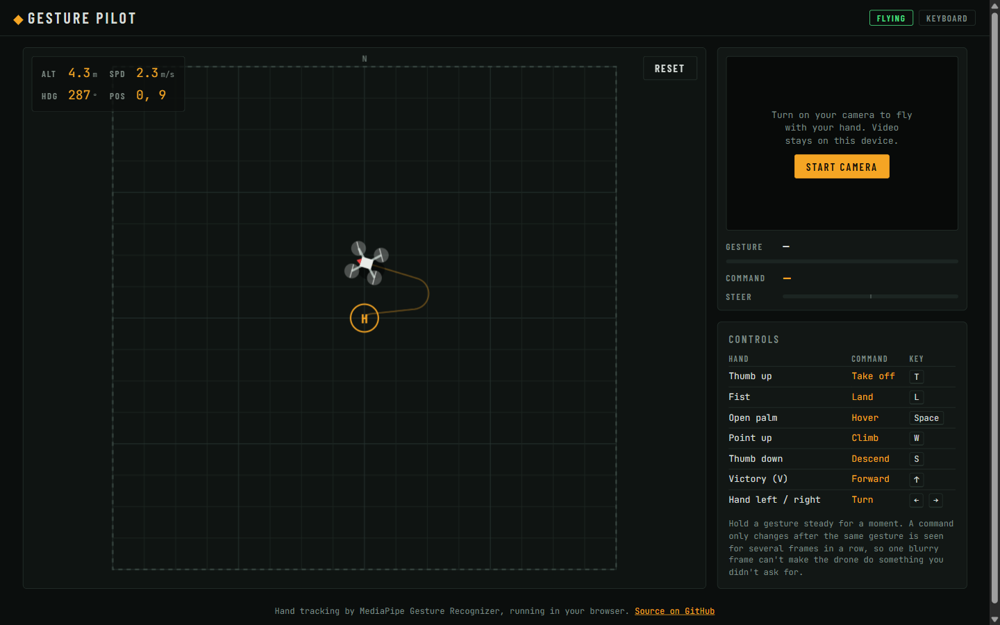

# Gesture Pilot

Fly a simulated drone with hand gestures from your webcam, in the browser.

**Live:** https://miaoricle.github.io/gesture-pilot/



Hand tracking and gesture recognition run on your device with [MediaPipe Gesture Recognizer](https://ai.google.dev/edge/mediapipe/solutions/vision/gesture_recognizer). Video frames never leave the browser. The only network request is the first download of the ~8 MB model. No camera? Every command also has a keyboard key.

## Controls

| Hand | Command | Key |
| --- | --- | --- |
| Thumb up | Take off | <kbd>T</kbd> |
| Fist | Land | <kbd>L</kbd> |
| Open palm | Hover | <kbd>Space</kbd> |
| Pointing up | Climb | <kbd>W</kbd> |
| Thumb down | Descend | <kbd>S</kbd> |
| Victory (V) | Fly forward | <kbd>↑</kbd> |
| Hand left / right of centre | Turn | <kbd>←</kbd> <kbd>→</kbd> |

## Why it doesn't twitch

Classifying every video frame on its own is noisy. A hand turning between two poses can flicker through three different classes in a fraction of a second. If every frame drove the drone directly, it would lurch around.

So the gesture goes through a small smoother ([`src/control.ts`](src/control.ts)) before it becomes a command:

- A frame only counts if the model's confidence is at least 0.6.
- The command changes only after the **same** gesture has been seen in **6 consecutive frames** (about 0.2 s at 30 fps). The meter under the gesture name shows that build-up.
- Losing the hand doesn't cancel the current command. The drone keeps doing what it was told, so a hand briefly leaving the frame isn't treated as an instruction.
- Steering uses where your wrist is in the (mirrored) frame, with a dead zone in the middle so a resting hand flies straight.

This is the same problem that motivated our research on [real-time hand gesture recognition for UAV control with an LSTM](#background): the decision needs to look at a short sequence of frames, not a single one. Here a simple frame-count rule stands in for the sequence model, so the demo stays small and runs anywhere.

## How it's built

- **TypeScript + Canvas, no framework.** The field view, drone and HUD are drawn by hand ([`src/map.ts`](src/map.ts)).
- **Drone model** ([`src/drone.ts`](src/drone.ts)): take-off/flying/landing phases, acceleration and drag, a ceiling, a fenced arena, and a cap on time steps so switching tabs doesn't teleport the drone.
- **MediaPipe runtime is self-hosted.** The WebAssembly files are copied from the npm package at build time (`scripts/copy-wasm.mjs`), so the code and the runtime are always the same version. The GPU delegate is tried first, with a CPU fallback.
- **Tests** ([`src/sim.test.ts`](src/sim.test.ts)) cover the smoother (steady gestures, flicker rejection, low confidence, lost hand), steering, and the flight model (take-off, turning, landing, ceiling, fence). CI runs them before every deploy.

```bash
npm install
npm run dev      # http://localhost:5173, camera works on localhost
npm test
npm run build
```

Camera access needs `https` or `localhost`. Chrome, Edge and Firefox on desktop and Android work. Recognition is best with your hand well lit and in front of a plain background.

## Background

This project is a browser demo of the idea behind *Real-Time Hand Gesture Recognition UAVs Control Using Long Short-Term Memory (LSTM)*, which I co-authored at ITS Surabaya. The paper uses its own LSTM model on landmark sequences. This demo uses MediaPipe's pre-trained gesture classifier, so it is a demonstration of the interaction, not a reproduction of the paper's results.

## License

MIT
